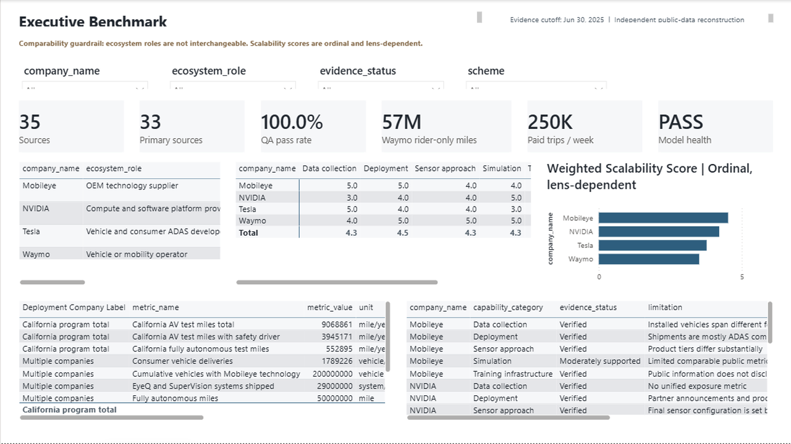

# Autonomous Driving Technology, Cloud Computing & Scalability Benchmark

A source-traceable analytics project comparing **Tesla, Waymo, NVIDIA, and Mobileye** across autonomous-driving technology, safety evidence, deployment, cloud-computing cost, and scalability.

**Tools:** Python, SQL, SQLite, Power BI, DAX, Power Query, Excel, and Jupyter<br>
**Evidence cutoff:** June 30, 2025<br>
**Project status:** Complete and validated<br>
**Data validation:** 20/20 checks passed



---

## Project origin

This project began with a difficult but important question:

> How can four companies involved in autonomous driving be compared fairly when they operate in fundamentally different parts of the ecosystem?

I first worked on this business problem through a **Microsoft client-based global internship facilitated by the Russell Palmer Career Management Center at Michigan State University**. The original engagement focused on autonomous-driving technology, cloud computing, competitive positioning, and scalability.

During that experience, I researched the autonomous-driving landscape, organized technical and business evidence, compared company strategies, evaluated infrastructure and scalability considerations, and translated the analysis into decision-oriented findings.

After the internship, I independently reconstructed and substantially expanded the project into the complete public analytics portfolio in this repository. I rebuilt the research using traceable public sources and developed a reproducible technical solution that includes:

- A governed source and evidence register
- Raw, staging, cleaned, reporting, and quality-controlled data layers
- An end-to-end Python pipeline
- A normalized SQLite analytical database
- SQL transformations, validation queries, and reporting views
- Four executed analytical notebooks
- Safety and deployment analysis
- Standardized GPU and cloud-cost scenarios
- Sensitivity analysis
- A role-aware scalability framework
- A complete Power BI semantic model and dashboard
- Automated quality-assurance checks
- An executive summary and full analytical report

> **Professional disclosure:** I was not employed by Microsoft. This repository is an independent public reconstruction and extension of an earlier Microsoft client-based internship project. It uses public information and does not contain Microsoft-internal data, confidential company information, or the exact historical client deliverables.

---

## What I did

I completed the public reconstruction as an end-to-end analytics project, from research design and evidence governance through modeling, analysis, visualization, validation, and executive communication.

| Workstream | My contribution | Result |
|---|---|---|
| Research design | Reframed the comparison around company roles instead of forcing four different businesses into one leaderboard | A more defensible benchmarking framework |
| Source research | Collected and documented regulatory, financial, technical, government, and company evidence | 35 traceable sources, including 33 primary sources |
| Data governance | Added source IDs, publication dates, reliability classifications, limitations, cutoff controls, and supported claims | Important findings can be traced to their evidence |
| Data engineering | Built raw, manually compiled, staging, cleaned, reporting, and data-quality layers | A reproducible and auditable workflow |
| Python development | Created acquisition, cleaning, validation, analysis, cost-modeling, scoring, database, and export scripts | 11 reusable Python pipeline components |
| SQL development | Designed the normalized schema, loading logic, transformations, analytical queries, validation checks, and reporting views | A populated SQLite database and SQL Server-compatible schema |
| Exploratory analysis | Developed notebooks for source auditing, safety and deployment, GPU cost, and scalability | Four executed and reviewable notebooks |
| Scenario modeling | Built standardized GPU training, simulation, storage, checkpoint, and egress cost scenarios | 54 comparable cost scenarios |
| Sensitivity analysis | Tested GPU hours, experiment count, storage, utilization, pricing model, and egress assumptions | Clear identification of the largest modeled cost drivers |
| Scalability analysis | Designed 12 criteria and three alternative weighting lenses | Role-aware comparisons without presenting an artificial universal winner |
| Power BI modeling | Built the semantic model, relationships, measures, formatting, and interaction logic | 18 tables, 20 relationships, and 53 explicit DAX measures |
| Dashboard development | Designed four analytical pages and a hidden evidence-detail page | 64 validated visuals |
| Quality assurance | Created tests for keys, dates, sources, costs, weights, ranges, and referential integrity | 20/20 supplied validation checks passed |
| Business communication | Produced an executive summary, analytical report, dashboard export, methodology, and limitation register | A complete package for technical and nontechnical audiences |

---

## Business problem

Autonomous-driving companies are often compared using a single leaderboard. That approach is misleading because the companies in this project play very different roles.

| Company | Primary ecosystem role | Appropriate analytical lens |
|---|---|---|
| Tesla | Consumer vehicle manufacturer and supervised driver-assistance developer | Consumer distribution, vehicle integration, fleet learning, and supervised automation |
| Waymo | Geofenced Level 4 autonomous-mobility operator | Rider-only deployment, operating-domain expansion, fleet operations, and exposure-aligned safety evidence |
| NVIDIA | Compute, software, simulation, training, and reference-platform supplier | Infrastructure capability, ecosystem adoption, platform breadth, and customer integration |
| Mobileye | Automotive chip, ADAS, mapping, and autonomy-platform supplier | OEM integration, installed base, product tiers, and commercial scale |

Miles, vehicles, systems shipped, deliveries, trips per week, compute specifications, and incident reports cannot be combined into a single scale metric without losing their meaning.

### Questions addressed

The analysis investigates:

1. What role does each company play in the autonomous-driving ecosystem?
2. How do their commercial models differ?
3. How do their sensor and perception strategies compare?
4. How does each company collect data and develop models?
5. What approaches are used for in-vehicle computing?
6. What training and simulation capabilities are publicly documented?
7. What safety evidence is available and genuinely comparable?
8. How do deployment scale, geography, and operating domain differ?
9. What would standardized GPU training and simulation workloads cost?
10. Which assumptions have the greatest effect on modeled cloud cost?
11. How do partnerships and integration strategies influence scalability?
12. What technical, operational, regulatory, commercial, and cost constraints affect each company?
13. Which conclusions are verified, inferred, scenario-based, or unsupported by public evidence?

---

## Analytical approach

The project uses a role-aware comparative case-study and benchmarking design. The unit of comparison changes according to the question:

- **Vehicle and mobility operations:** Tesla and Waymo
- **Consumer driver-assistance technology:** Tesla and applicable Mobileye product tiers
- **Compute and software platforms:** NVIDIA, Mobileye, Tesla, and Waymo where public evidence exists
- **OEM technology supply:** NVIDIA and Mobileye
- **Standardized cloud cost:** Cloud-provider configurations under identical modeled workloads
- **Scalability:** All four companies using transparent criteria and alternative weighting assumptions

No cross-company metric is combined unless the unit, exposure basis, reporting threshold, geography, period, and interpretation are reasonably aligned.

---

## End-to-end architecture

```text
Public regulatory, financial, technical, and company sources
                              |
                              v
                    Source and evidence register
                              |
                              v
             data/raw + data/manually_compiled
                              |
                              v
                         data/staging
        Standardization, parsing, hashing, and auditing
                              |
                              v
                         data/cleaned
       Canonical dimensions, facts, keys, and categories
                              |
              +---------------+---------------+
              |                               |
              v                               v
       SQLite analytical model          data/reporting
              |                               |
              v                               v
     SQL analytical views          Power BI-ready tables
              |                               |
              +---------------+---------------+
                              |
                              v
          Notebooks, reports, scenario models, and dashboard
                              |
                              v
                    Automated QA validation
```

---

## Data engineering

I separated the data into clearly defined analytical layers.

### Raw and manually compiled data

The raw layer preserves original source structures and field names. The manually compiled layer contains source-controlled facts extracted from government materials, regulatory filings, company filings, technical documentation, dated releases, cloud-provider documentation, and carefully labeled corroborating sources.

For large NHTSA files, the repository contains official acquisition URLs, a retrying download script, and a verified schema excerpt. The excerpt validates ingestion and transformation logic; it is not presented as a representative incident population.

### Staging and cleaned data

The staging and cleaning process performs:

- Whitespace and field-name standardization
- Date parsing
- Company-name normalization
- State and geography standardization
- Category harmonization
- Numeric type conversion
- Record-hash generation
- Latest-version incident deduplication
- Canonical company and source keys
- Unit and reporting-period preservation
- Evidence-status classification

### Reporting and quality layers

The reporting layer creates datasets for Power BI, safety analysis, deployment analysis, cloud-cost scenarios, sensitivity analysis, scalability scoring, and written findings. The data-quality layer stores validation results, missing-value profiles, and record-count reconciliation.

No record is silently removed. Exclusions, unavailable files, deduplication rules, and transformation effects are documented.

---

## Python work

The [`python`](python) directory contains the reusable pipeline:

| Script | Purpose |
|---|---|
| `config.py` | Central project paths and shared configuration |
| `acquire_data.py` | Source acquisition, retries, checksums, and source logging |
| `clean_data.py` | Standardization, parsing, deduplication, and canonical output creation |
| `validate_data.py` | Automated data-quality and reconciliation checks |
| `analyze_incidents.py` | Incident evidence processing and carefully scoped analysis |
| `analyze_deployment.py` | Deployment, mileage, trips, systems, and geography analysis |
| `gpu_cost_model.py` | GPU training, simulation, storage, and transfer cost calculations |
| `scalability_model.py` | Criterion scoring and alternative weighting calculations |
| `export_powerbi_tables.py` | Power BI-ready table and workbook generation |
| `build_database.py` | SQLite database generation from canonical cleaned files |
| `run_pipeline.py` | Complete workflow orchestration |

All project paths are relative to the repository root.

---

## SQL work

The [`sql`](sql) package demonstrates:

- Normalized schema design
- Primary and foreign keys
- Indexes and integrity constraints
- Data loading and transformation logic
- Joins and common table expressions
- Window functions
- Conditional aggregation
- Date logic and ranking
- Latest-version deduplication
- Cost reconciliation
- Analytical queries
- Reporting views
- Referential-integrity validation

The delivered [`autonomous_driving.db`](sql/autonomous_driving.db) database is populated and validated. A SQL Server-compatible schema is also included for portability beyond SQLite.

### Core analytical tables

- `dim_company`
- `dim_date`
- `dim_geography`
- `dim_source`
- `dim_technology`
- `fact_av_incident`
- `fact_deployment_mileage`
- `fact_disengagement`
- `fact_company_capability`
- `fact_partnership`
- `fact_gpu_pricing`
- `fact_training_cost_scenario`
- `fact_scalability_score`
- `bridge_company_technology`
- `qa_validation_result`

The Power BI model does not fabricate a separate disengagement table where no distinct delivered workbook sheet supports one.

---

## Analytical notebooks

The [`notebooks`](notebooks) directory contains four executed notebooks:

1. [`01_data_acquisition_and_audit.ipynb`](notebooks/01_data_acquisition_and_audit.ipynb)
2. [`02_safety_and_deployment_analysis.ipynb`](notebooks/02_safety_and_deployment_analysis.ipynb)
3. [`03_gpu_cost_scenarios.ipynb`](notebooks/03_gpu_cost_scenarios.ipynb)
4. [`04_scalability_analysis.ipynb`](notebooks/04_scalability_analysis.ipynb)

The notebooks use project-relative paths and retain their executed outputs for review.

---

## Safety and deployment methodology

Safety analysis is especially vulnerable to misleading comparisons. This project therefore avoids:

- Treating raw incident totals as safety rates
- Dividing incidents by unrelated delivery or fleet-size measures
- Comparing Tesla Level 2 reports directly with Waymo ADS reports without qualification
- Assigning customer fleet outcomes directly to NVIDIA or Mobileye
- Treating the bundled incident extract as a comprehensive population
- Ignoring differences in geography, operating domain, telemetry, road type, vehicle type, or reporting threshold

NHTSA reports are deduplicated by report ID, with the latest version retained.

Waymo's 56.7 million rider-only-mile study is treated as exposure-aligned evidence because it includes a mileage denominator and matched human benchmarks. It remains company-authored research limited to Waymo's operating domains.

Tesla safety publications are not merged with Waymo's matched analysis because the crash definitions, operating environments, exposure measures, road mix, and benchmark construction differ. NVIDIA and Mobileye are evaluated primarily as platform and component suppliers rather than homogeneous fleet operators.

Deployment indicators retain their original units and periods. Miles, rider-only miles, trips, vehicles, systems shipped, installed vehicles, deliveries, service areas, and California program mileage remain separate.

---

## GPU and cloud-cost model

I created standardized scenarios to examine how infrastructure choices affect model-development economics. The outputs are analytical scenarios, not estimates of confidential company spending.

| Scenario | Required GPUs | Training hours per run | Runs | Storage | Simulation GPU hours |
|---|---:|---:|---:|---:|---:|
| Small experimentation | 1 | 24 | 5 | 1 TB | 100 |
| Medium development | 8 | 168 | 10 | 20 TB | 10,000 |
| Large AV training | 64 | 720 | 12 | 200 TB | 100,000 |

The model includes training compute, simulation compute, persistent storage, checkpoint storage, egress, utilization, instance count, provider configuration, and alternative pricing assumptions.

Three standardized pricing treatments are modeled:

- **On-demand:** 1.00 times the price snapshot
- **Committed scenario:** 0.70 times
- **Interruptible scenario:** 0.45 times

The committed and interruptible factors are explicit analytical assumptions, not provider quotes.

```text
instances = ceiling(required GPUs / GPUs per instance)

training compute =
instances x hourly price x hours per run x runs
/ utilization x price factor

simulation compute =
simulation GPU hours x price per GPU hour
/ utilization x price factor

storage =
(storage TB + checkpoint TB) x months x price per TB-month

egress = egress TB x egress price per TB

total = training compute + simulation compute + storage + egress
```

The sensitivity analysis varies GPU hours, experiment count, storage volume, utilization, price factor, and egress price. Compute requirements, experiment volume, utilization, and pricing treatment produce the largest modeled changes.

---

## Scalability framework

I designed a 12-criterion framework scored from 1 to 5:

1. Data scale
2. Training infrastructure
3. Simulation capability
4. In-vehicle compute
5. Sensor complexity
6. Geographic scalability
7. Hardware dependence
8. OEM or fleet integration
9. Deployment maturity
10. Regulatory exposure
11. Commercial flexibility
12. Cost scalability

Each criterion includes a definition, measurement approach, evidence source, score, weight, missing-data treatment, and interpretation warning.

Three weighting lenses are included:

- Baseline
- Level 4 operator
- Platform supplier

```text
weighted score =
sum(criterion score x criterion weight)
/
sum(criterion weight)
```

The scores are ordinal and weighting-dependent. They expose strategic tradeoffs rather than selecting a universal winner or creating a safety ranking.

---

## Power BI solution

The [`powerbi`](powerbi) directory contains the complete report package:

- [`Autonomous_Driving_Benchmark.pbix`](powerbi/Autonomous_Driving_Benchmark.pbix) - refreshed Power BI Desktop report
- [`Autonomous_Driving_Benchmark.pbip`](powerbi/Autonomous_Driving_Benchmark.pbip) - source-controlled Power BI project
- [`Autonomous_Driving_Benchmark.Report`](powerbi/Autonomous_Driving_Benchmark.Report) - PBIR report definition
- [`Autonomous_Driving_Benchmark.SemanticModel`](powerbi/Autonomous_Driving_Benchmark.SemanticModel) - TMDL semantic model
- [`Autonomous_Driving_Benchmark.pdf`](powerbi/Autonomous_Driving_Benchmark.pdf) - four-page PDF export
- [`Executive_Benchmark.png`](powerbi/Executive_Benchmark.png) - executive dashboard preview
- [`powerbi_ready_data.xlsx`](powerbi/powerbi_ready_data.xlsx) - model-ready workbook
- [`Autonomous_Driving_Benchmark_QA.md`](powerbi/Autonomous_Driving_Benchmark_QA.md) - dashboard QA results
- [`build_powerbi_project.py`](powerbi/build_powerbi_project.py) - reproducible PBIP, PBIR, and TMDL generator

### Semantic model

The completed model contains:

- 18 model tables
- 20 single-direction relationships
- 53 explicit DAX measures
- Seven organized measure folders
- Four canonical companies
- Source-traceable analytical facts
- A disconnected weighting-scheme selector
- Dedicated warning and quality-control measures

The model avoids ambiguous bidirectional relationship paths and keeps cost-scenario filters separate from unrelated company evidence.

### Report pages

| Page | Purpose | Visuals |
|---|---|---:|
| Executive Benchmark | Executive KPIs, role matrix, capability evidence, deployment context, and weighted scalability | 18 |
| Technology & Workflow | Sensor strategies, architecture, development workflow, compute, and evidence strength | 13 |
| Safety & Deployment | Exposure-aligned indicators, deployment evidence, geography, and limitations | 12 |
| GPU Cost & Scalability | Cost scenarios, component breakdowns, sensitivity analysis, criteria, and weighting lenses | 19 |
| Evidence & Source Detail | Hidden source and limitation detail page | 2 |

The report contains 64 visuals. All pages were opened and checked in Power BI Desktop. The report was refreshed, saved as PBIX, exported to PDF, and visually validated at normal viewing size.

---

## Key findings

### The four companies are not identical competitors

Tesla and Waymo have direct vehicle or mobility exposure. NVIDIA and Mobileye primarily provide platforms, computing systems, software, chips, or components that customers integrate. A single cross-company ranking would hide these differences.

### Waymo had the strongest publicly available exposure-aligned Level 4 safety evidence within the cutoff

Waymo's May 2025 research used 56.7 million rider-only miles and matched human benchmarks. This provides stronger exposure alignment than raw incident counts, but it does not create a universal four-company safety ranking.

### Tesla had the broadest direct consumer-distribution channel in the comparison

Tesla's public filings describe a primarily vision-based supervised system, custom inference hardware, fleet learning, and Cortex infrastructure. Public system-level mileage denominators by software version and operating domain were not available, limiting direct rate comparisons.

### NVIDIA offered the broadest public train-simulate-deploy platform

NVIDIA provides infrastructure spanning model training, simulation, in-vehicle computing, operating software, and reference architectures. Customer vehicles, sensors, software integration, and fleet operations prevent direct attribution of customer safety outcomes to NVIDIA.

### Mobileye demonstrated significant OEM scale

Mobileye reported 29 million EyeQ and SuperVision systems shipped in 2024 and technology installed in more than 200 million vehicles. Those figures span multiple generations, products, customers, and automation levels.

### Raw incident totals are inadequate for direct safety comparison

NHTSA ADS and Level 2 reporting requirements differ. Companies also have different telemetry, exposure, geography, software versions, vehicle types, operating domains, and reporting processes.

### Compute dominates standardized cloud-cost scenarios

GPU hours, required GPU count, experiment volume, utilization, and pricing treatment drive most modeled cost variation. Storage and transfer become more important as retained datasets, checkpoints, and simulation outputs grow.

### Scalability follows multiple paths

The analysis identifies different scalability patterns across consumer fleet distribution, geofenced Level 4 operations, horizontal compute and simulation platforms, and OEM technology integration. The framework is therefore a decision aid rather than a winner-selection model.

---

## Evidence governance

The source register contains 35 documented sources and records the organization, title, source type, publication date, historical period, access date, URL, supported variables or claims, reliability, limitations, primary or secondary status, and cutoff validation.

Priority evidence includes NHTSA materials, California DMV reports, Waymo safety research, SEC filings, annual reports, technical documentation, dated company announcements, cloud-provider documentation, and academic research.

The complete registers are available in:

- [`source_log.xlsx`](source_log.xlsx)
- [`data/manually_compiled/source_log.csv`](data/manually_compiled/source_log.csv)

### Evidence-strength labels

| Label | Meaning |
|---|---|
| Verified | Directly supported by a primary source |
| Moderately supported | Supported at a high level but missing comparable quantitative detail |
| Inference | Reasoned interpretation based on multiple verified facts |
| Scenario | Output produced from explicit analytical assumptions |
| Unsupported | Public evidence cannot answer the question responsibly |

---

## Data quality and validation

The automated quality layer checks duplicate keys, missing values, data types, dates, company names, geography, units, categories, numeric ranges, source traceability, referential integrity, incident deduplication, record counts, scenario utilization, cost reconciliation, score bounds, and weighting totals.

### Final validation result

- **20 of 20 validation checks passed**
- **100% QA pass rate**
- **Zero SQLite foreign-key violations**
- **Every weighting scheme totals 100**
- **Every scalability score remains within the 1-to-5 range**
- **Every source satisfies the June 30, 2025 cutoff**
- **Scenario totals reconcile to their cost components**

The full results are available in [`outputs/quality_report.xlsx`](outputs/quality_report.xlsx).

---

## Repository structure

```text
autonomous-driving-benchmark/
|
|-- data/
|   |-- raw/                  Original source structure and schema excerpt
|   |-- manually_compiled/    Source-controlled public evidence
|   |-- staging/              Standardized intermediate tables
|   |-- cleaned/              Canonical analytical tables
|   |-- reporting/            Analysis and Power BI-ready tables
|   `-- data_quality/         Validation and reconciliation outputs
|
|-- documentation/            Limitations, reproduction, sources, transformations
|-- notebooks/                Four executed analytical notebooks
|-- python/                   Reproducible Python pipeline
|-- sql/                      Schema, transformations, queries, views, database
|-- outputs/                  Findings, charts, QA, and analytical outputs
|-- powerbi/                  PBIX, PBIP, PBIR, TMDL, PDF, PNG, DAX, workbook
|
|-- assumptions_and_limitations.xlsx
|-- data_dictionary.xlsx
|-- executive_summary.pdf
|-- interview_guide.docx
|-- methodology.md
|-- project_report.docx
|-- project_report.pdf
|-- requirements.txt
|-- source_log.xlsx
`-- MANIFEST.csv
```

[`MANIFEST.csv`](MANIFEST.csv) records the repository contents, file sizes, hashes, and artifact descriptions.

---

## Main deliverables

| Deliverable | File |
|---|---|
| Complete Power BI report | [`Autonomous_Driving_Benchmark.pbix`](powerbi/Autonomous_Driving_Benchmark.pbix) |
| Source-controlled Power BI project | [`Autonomous_Driving_Benchmark.pbip`](powerbi/Autonomous_Driving_Benchmark.pbip) |
| Dashboard PDF export | [`Autonomous_Driving_Benchmark.pdf`](powerbi/Autonomous_Driving_Benchmark.pdf) |
| Executive dashboard image | [`Executive_Benchmark.png`](powerbi/Executive_Benchmark.png) |
| Power BI-ready workbook | [`powerbi_ready_data.xlsx`](powerbi/powerbi_ready_data.xlsx) |
| Executed analytical database | [`autonomous_driving.db`](sql/autonomous_driving.db) |
| Full analytical report | [`project_report.pdf`](project_report.pdf) |
| Editable project report | [`project_report.docx`](project_report.docx) |
| Executive summary | [`executive_summary.pdf`](executive_summary.pdf) |
| Methodology | [`methodology.md`](methodology.md) |
| Source register | [`source_log.xlsx`](source_log.xlsx) |
| Data dictionary | [`data_dictionary.xlsx`](data_dictionary.xlsx) |
| Assumption and limitation register | [`assumptions_and_limitations.xlsx`](assumptions_and_limitations.xlsx) |
| Quality report | [`quality_report.xlsx`](outputs/quality_report.xlsx) |
| Reproducibility guide | [`reproducibility_guide.md`](documentation/reproducibility_guide.md) |

---

## Reproducing the project

### Requirements

- Python 3.10 or later
- Packages in `requirements.txt`
- SQLite command-line tools are optional
- Power BI Desktop is needed only to open or modify the PBIX/PBIP report

### Clone and install

```bash
git clone https://github.com/JntNayeemMSBDSA/autonomous-driving-benchmark.git
cd autonomous-driving-benchmark
python -m pip install -r requirements.txt
```

### Run the bundled pipeline

```bash
python python/run_pipeline.py
```

This regenerates the canonical analytical outputs, cost scenarios, scalability results, Power BI tables, quality results, and SQLite database from the bundled cutoff-safe evidence.

### Acquire the official NHTSA archives and rebuild

```bash
python python/acquire_data.py
python python/run_pipeline.py
```

The acquisition script downloads the archived ADS, Level 2 ADAS, and OTHER files, calculates checksums, and logs failures without silently substituting data. The OTHER archive is retained for audit but is not loaded into the incident fact because its reporting scope differs.

### Rebuild or inspect the database

```bash
python python/build_database.py
sqlite3 sql/autonomous_driving.db
```

Then run:

```sql
.read sql/05_analytical_queries.sql
```

Execute notebooks from the project root so relative paths resolve correctly.

---

## Known limitations

Important questions remain unresolved because the necessary information is not reliably public:

- Exact company training expenditure
- Internal dataset size
- Proprietary model architecture
- Sensor bill of materials
- Enterprise cloud discounts
- Per-vehicle operating cost
- Software-version exposure
- Matched fleet safety denominators
- Internal simulation volume and cluster utilization
- Customer-specific supplier integration
- Comparable operating-domain definitions

Additional limitations include:

- Large official NHTSA archive files are not redistributed here
- The incident excerpt validates the pipeline but is not a representative population
- NHTSA ADS and Level 2 reporting thresholds differ
- California DMV reports cover a limited testing context
- Mutable web pages may change after the cutoff
- TOPS and TFLOPS are not universally comparable across architectures
- Vehicles, systems, deliveries, installed base, trips, and miles are not interchangeable
- Scalability results depend on criteria definitions and weighting choices
- Cost scenarios are models rather than invoices or company-spending estimates

The complete limitation register is available in [`documentation/known_limitations.md`](documentation/known_limitations.md) and [`assumptions_and_limitations.xlsx`](assumptions_and_limitations.xlsx).

---

## Responsible interpretation

This project intentionally does not:

- Declare one universal autonomous-driving winner
- Treat raw incident totals as safety rates
- Combine unlike deployment units
- Attribute customer fleet outcomes directly to component suppliers
- Rank platforms using TOPS alone
- Present standardized scenarios as confidential expenditure
- Use post-cutoff evidence to explain historical performance
- Impute unavailable private metrics as leading performance
- Hide uncertainty or unsupported questions

The goal is not to simplify away the differences among the companies. It is to make those differences understandable, measurable where possible, and explicit where direct comparison is not defensible.

---

## Skills demonstrated

- Business and competitive analysis
- Research design and evidence governance
- Python data engineering
- SQL and relational modeling
- SQLite database development
- Data cleaning and standardization
- Exploratory analysis
- Scenario modeling and sensitivity analysis
- KPI and metric design
- Power Query and DAX
- Power BI semantic modeling and dashboard development
- Automated quality assurance
- Technical documentation
- Executive communication
- Responsible analytical interpretation

---

## Author

**Jannatul Nayeem**

Data analytics and business intelligence professional focused on building clear, reproducible, and decision-oriented analytical products.

GitHub: [JntNayeemMSBDSA](https://github.com/JntNayeemMSBDSA)

---

## Final note

This repository represents more than a dashboard. It documents the full path from an ambiguous strategic question to a governed data model, reproducible analysis, transparent assumptions, validated outputs, and an executive-facing analytical product.

The central lesson from this project is that responsible analytics is not only about calculating metrics. It is also about knowing when two metrics should not be compared, documenting what the evidence can support, and communicating uncertainty as clearly as the findings.
